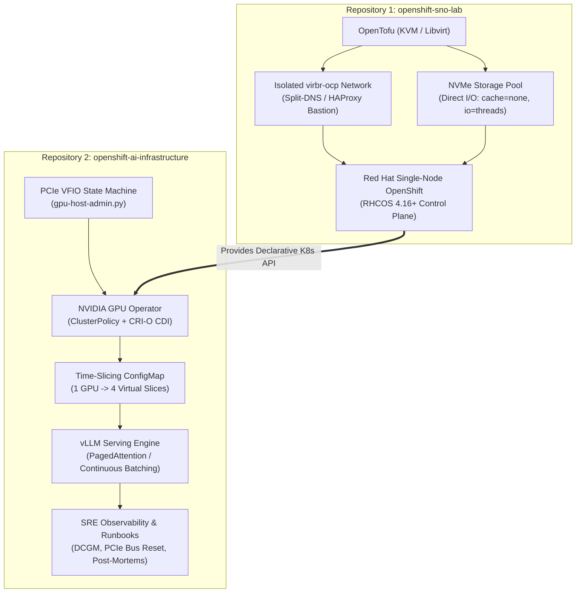
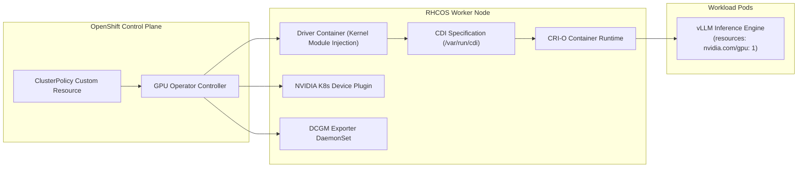

# From Bare Metal to vLLM: Architecting an OpenShift AI Infrastructure Lab from First Principles

In the current industry conversation around Artificial Intelligence, the spotlight is almost exclusively focused on high-level models, prompt engineering, and Python frameworks. 

However, in enterprise infrastructure engineering, the reality is very different: **AI infrastructure is a bare-metal, storage latency, and Site Reliability Engineering (SRE) problem in disguise.**

When models fail to serve, clusters lose quorum, or inference latencies spike, the root cause is rarely the neural network code. It is almost always found in the underlying physical and systems primitives:
- A PCIe bus lockup or driver crash that panics the kernel.
- An IOMMU grouping conflict that leaks DMA between devices.
- High `etcd` disk `fsync` latency that triggers a Kubernetes control-plane election loop.
- Memory fragmentation in GPU VRAM (KV cache) causing out-of-memory cascades.
- Severe electrical power delivery spikes during CUDA JIT compilation tripping host power supplies.

To explore these technologies deeply and apply my 30-year foundation in bare-metal compute, hypervisors, and distributed systems to modern accelerator stacks, I designed and built an enterprise-grade AI infrastructure testbed from scratch.

Here is the architectural breakdown of how I designed it, why I made specific trade-offs, and what I learned along the way.

---

## 1. Architectural Separation of Concerns: Why Two Repositories?

When setting up a private lab for modern containerized AI workloads, the easiest shortcut is to throw everything into a single monolithic repository: hypervisor configs, cluster provisioning scripts, Kubernetes manifests, and application code.

I deliberately rejected that approach. In production, platform infrastructure and application workloads have fundamentally different lifecycles, blast radiuses, and ownership models. 

I split the architecture into two strictly decoupled repositories:



1. **[`openshift-sno-lab`](https://github.com/celttechie/openshift-sno-lab): Declarative Platform Substrate**  
   Responsible solely for provisioning the Single-Node OpenShift (SNO 4.16+) hypervisor substrate on bare-metal Dell Precision workstation hardware via OpenTofu and KVM/libvirt. It guarantees zero host collision, isolated networking, NVMe storage performance, and zero-trust cryptographic SSH key pinning.
2. **[`openshift-ai-infrastructure`](https://github.com/celttechie/openshift-ai-infrastructure): Accelerator & Workload Layer**  
   Consumes the Kubernetes API provided by the substrate. It is responsible for host PCIe VFIO driver binding, deploying the NVIDIA GPU Operator, configuring GPU time-slicing, orchestrating production vLLM inference serving, and codifying Day-2 SRE operational runbooks.

By enforcing this boundary, the OpenShift cluster can be upgraded, torn down, or re-initialized without touching the AI workload configs, and model serving deployments can iterate rapidly without risking hypervisor stability.

---

## 2. Taming the Physical Substrate: PCIe VFIO & `etcd` Storage Latency

A container platform is only as reliable as the bare metal underneath it. Two critical physical constraints had to be solved before a single container could be scheduled:

### Guaranteeing `etcd` fsync Latency (<10ms)
Kubernetes relies on `etcd` as its distributed key-value store. If disk write latency (`fsync`) exceeds 10 milliseconds (p99), `etcd` members miss heartbeats, trigger election storms, and the cluster enters an unrecoverable crash loop.

When virtualizing Single-Node OpenShift on KVM, host filesystem caching introduces unpredictable I/O jitter. To satisfy the <10ms requirement deterministically:
* Dedicated an NVMe PCIe adapter pool (`/mnt/nvme_data`).
* Configured KVM Libvirt disk domain overrides using **Direct I/O** (`cache=none`) to bypass the host page cache entirely.
* Configured dedicated I/O threads (`io=threads`) to isolate disk writes from hypervisor CPU contention.

### Host PCIe VFIO Binding & IOMMU Grouping
To provide bare-metal CUDA compute to containers inside OpenShift, the physical NVIDIA GPU on the host had to be passed through cleanly. 

Normally, the host Linux kernel automatically binds its `nvidia` or `nouveau` driver to the GPU. To hand control over to the virtualized cluster:
* I wrote an automated Python state machine ([`gpu-host-admin.py`](https://github.com/celttechie/openshift-ai-infrastructure/blob/main/targets/t5600-homelab/gpu-host-admin.py)) that audits sysfs (`/sys/bus/pci/devices/`).
* Verified that the GPU and its onboard HDMI audio controller shared an isolated **IOMMU group** so Direct Memory Access (DMA) transactions would not bleed across devices.
* Executed dynamic unbinding from host drivers and bound the card to the kernel's `vfio-pci` driver prior to VM initialization.

---

## 3. Cloud-Native Accelerator Management: The GPU Operator & CDI

In legacy environments, exposing a GPU to a container required vendor-specific runtime wrappers (such as `nvidia-docker` or patching Docker daemons with `nvidia-container-runtime`). 

In a modern enterprise OpenShift cluster, that approach is an operational anti-pattern. Red Hat Enterprise Linux CoreOS (RHCOS) is an **immutable operating system**—the root filesystem is read-only, and you cannot SSH in to manually install driver packages.

I leveraged the **NVIDIA GPU Operator** with the modern **Container Device Interface (CDI)**:



### Why CDI (Container Device Interface) Matters
CDI is an open standard that allows container runtimes (CRI-O, containerd) to interact with complex third-party hardware without vendor-specific runtime hacks. The GPU Operator injects declarative CDI JSON specifications into `/var/run/cdi`, describing the exact device nodes and capabilities. When a pod requests `nvidia.com/gpu`, CRI-O uses standard Linux cgroups and mount namespaces to expose the card safely.

### Multiplexing Accelerators via Time-Slicing
Datacenter GPUs (like NVIDIA A100/H100) support Multi-Instance GPU (MIG) for hardware-level memory partitioning. On workstation GPUs (like the RTX 3060), running separate small inference tasks requires software multiplexing.

I configured the NVIDIA Device Plugin via a declarative ConfigMap for **time-slicing**:
```yaml
version: v1
sharing:
  timeSlicing:
    resources:
      - name: nvidia.com/gpu
        replicas: 4
```
This divides 1 physical GPU into 4 virtual slices, allowing concurrent test pods and health monitors to schedule against accelerator resources without starving each other.

---

## 4. High-Throughput Model Serving: vLLM, Continuous Batching & PagedAttention

Once hardware acceleration was operational inside OpenShift, I deployed **vLLM** as an enterprise OpenAI-compatible inference engine (serving models such as Qwen 2.5 and Llama 3.1).

### The Memory Problem: KV Cache Fragmentation
In transformer-based LLMs, generating text requires caching intermediate key-value attention tensors (the "KV Cache") for every prior token in the sequence. 

Traditional inference servers allocate large, contiguous VRAM buffers based on the maximum possible context length (e.g., 8,192 tokens). This leads to massive memory waste:
* **Internal fragmentation:** Memory reserved for tokens that were never generated.
* **Over-allocation:** Memory locked up by waiting requests, leading to premature Out-Of-Memory (OOM) errors.

### The Solution: PagedAttention
vLLM resolves this by borrowing one of the most fundamental concepts from OS kernel design: **virtual memory paging**.
Instead of allocating contiguous physical GPU memory, PagedAttention breaks the KV Cache into small blocks (pages) stored in non-contiguous VRAM. The attention layer translates virtual token positions to physical memory blocks dynamically, slashing memory waste to nearly **0%** and doubling the concurrent request capacity of the GPU.

### Continuous Batching
Rather than using static batching (where an entire batch of user queries must finish before the next batch starts), vLLM implements **continuous (iteration-level) batching**. As soon as one query outputs an `<end-of-sequence>` token, its memory pages are immediately freed, and a new incoming query is slotted into the active GPU execution loop on the very next token step.

---

## 5. SRE in Practice: Diagnosing Transient Power Trips & PCIe Bus Recovery

The defining mark of Site Reliability Engineering is how you handle unexpected hardware failures and operational toil. Two real-world incidents in this testbed highlight the difference between superficial administration and first-principles SRE:

### Incident 1: The Xeon PSU Power-Trip Post-Mortem
During initial workload validation, running heavy CUDA JIT compilation caused the physical workstation host to suddenly shut down completely with zero kernel panic logs.

Rather than dismissing it as a random glitch, I initiated a formal SRE Root Cause Analysis ([`Incident 001 Post-Mortem`](https://github.com/celttechie/openshift-ai-infrastructure/blob/main/docs/post-mortems/2026-10-21-cpu-jit-psu-deadlock.md)):
1. **The Investigation:** Checked IPMI SEL (System Event Logs) and hardware telemetry. Discovered a power-supply overcurrent protection (OCP) trip on the 12V rail.
2. **The Root Cause:** CUDA JIT compilation heavily loaded all 24 Xeon CPU threads simultaneously while the GPU initialized at full TDP. The combined electrical inrush current exceeded the single-rail power budget.
3. **The SRE Resolution:** Configured CPU affinity and cgroup CPU quotas for CUDA compile jobs, capped compile parallelism to 12 cores, and scheduled heavy JIT compiles outside peak GPU inference cycles. Documented the failure mode in a blameless post-mortem with preventative monitoring alerts.

### Incident 2: Automated PCIe Bus Reset vs. Node Reboots
When an accelerator hangs or throws an Xid error under corrupted memory or driver panics, the naive operational response is to reboot the physical host. In a multi-tenant cluster, rebooting a physical node evacuates all healthy workloads and causes significant service disruption.

I authored an automated operational runbook ([`gpu-recovery.md`](https://github.com/celttechie/openshift-ai-infrastructure/blob/main/docs/runbooks/gpu-recovery.md)) utilizing the Linux kernel sysfs reset interface:
```bash
# Gracefully drain GPU pods from the node
oc adm drain <node-name> --ignore-daemonsets --delete-emptydir-data

# Force hardware reset directly across the PCIe bus without rebooting the host
echo 1 > /sys/bus/pci/devices/0000:03:00.0/reset

# Rebind driver and uncordon node
oc adm uncordon <node-name>
```
This recovers degraded accelerator silicon in under 15 seconds with zero disruption to the hypervisor or neighbor workloads.

---

## 6. Conclusion: Bridging 30 Years of Systems Engineering to the AI Era

Mastering modern cloud-native AI platforms doesn't require abandoning decades of foundational systems engineering. In fact, the opposite is true: **the engineers who understand bare-metal compute, PCIe buses, storage latency, and kernel drivers are uniquely positioned to make AI infrastructure truly reliable.**

By building this testbed from first principles, I was able to validate:
- How declarative GitOps and OpenTofu enforce clean separation of concerns.
- How immutable OS environments like RHCOS handle low-level kernel drivers and hugepages via MachineConfigs.
- How modern serving runtimes like vLLM optimize memory hierarchies through PagedAttention.
- How SRE discipline—from automated recovery runbooks to blameless post-mortems—turns fragile bleeding-edge technology into resilient enterprise platforms.

Whether managing 6,000 nodes of enterprise cloud compute or optimizing high-throughput GPU supercomputing clusters, the core principles remain unchanged: **understand the systems from the silicon up, automate deterministically, and engineer for failure resilience.**
