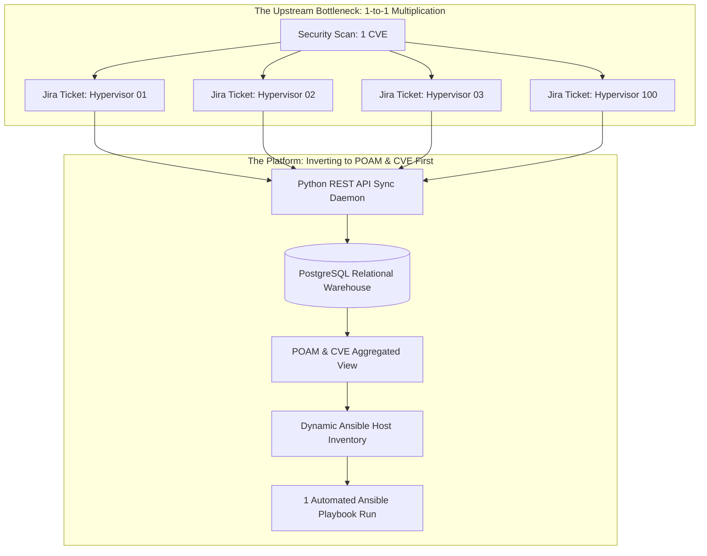
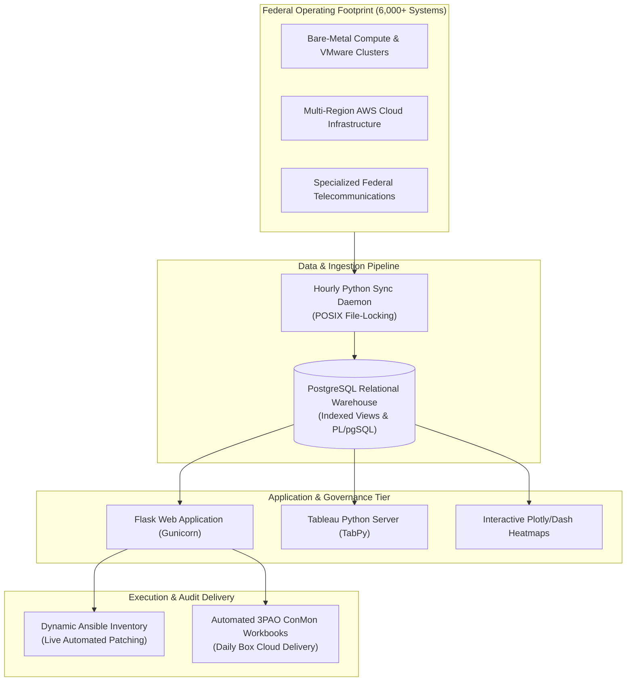
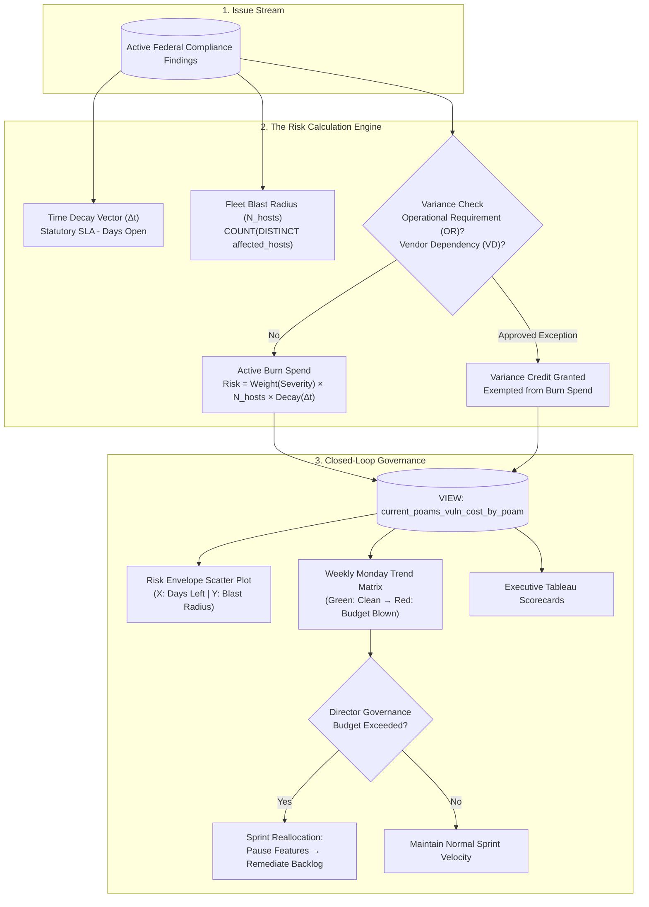
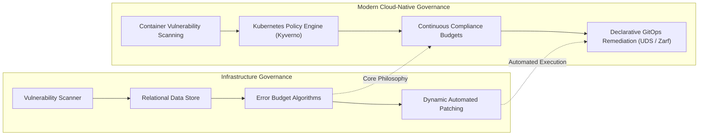

# Scaling Continuous Compliance with SRE Error Budgets: Protecting 6,000+ Multi-Cloud Federal Systems

When I first joined Cisco Webex as a contractor, vulnerability management felt completely reactive. 

My manager would periodically hand me a list of critical security vulnerabilities that needed to be patched across our infrastructure. Every time a new list landed on my desk, I felt like I was getting blindsided—constantly putting out fires instead of getting out ahead of the work. 

I wanted to be proactive, so I asked for direct access to our Jira instance so I could see vulnerabilities the moment they showed up and patch them immediately. But once I got inside, I ran straight into three major roadblocks:

1. **The Isolated Federal Boundary**: Our Jira instance lived strictly inside our isolated FedRAMP boundary. Almost nobody on the other engineering teams ever logged into it, which meant my manager and I were practically the only ones looking at the data. Other engineers quickly started coming to me just to ask what was open on their systems.
2. **Missing Enterprise Tooling**: The company hadn't licensed any of the enterprise portfolio management plugins or advanced add-ons needed to manage compliance tickets at scale.
3. **The "1-Host, 1-Ticket" Deluge**: The upstream automation connecting our Qualys scanner to Jira created a separate ticket for every single host affected by a CVE. If I had a cluster of 100 VMware ESXi hypervisors that needed the same routine kernel patch, I had 100 individual Jira tickets to track, update, and close.

I didn't have administrative access to change how Qualys ran or rewrite the upstream ticketing automation. I just had a painful, broken process that was eating up engineering hours. 

So I decided to build my own solution.

---

## 1. The Genesis: Inverting the Problem with Python and PostgreSQL

I started by using the Jira REST API to pull all open tickets past the boundary barrier and into a PostgreSQL database I designed from scratch. 

Once the data lived in a real relational database, I could flip the architecture upside down:



Instead of looking at hundreds of disconnected tickets for individual machines, I aggregated the data by **Plan of Action and Milestones (POAM)** and **CVE**. 

Then I connected that visibility directly to execution:
* I built dynamic REST endpoints in the web application (`vulnerability-browser`) that generated live host inventories directly formatted for Ansible (`/ansible/inventory/<poam_id>`).
* Instead of an engineer opening 100 Jira tickets, copying hostnames, and manually tracking progress, they could click a single link in the web interface to feed all affected hypervisors directly into an automated Ansible patching playbook.

What started as my own tool to escape reactive fire-fighting solved a major bottleneck for our entire group. My manager began using it regularly for executive reporting, and colleagues across our Compute, Storage, and Networking teams quickly adopted it. That grassroots success catalyzed my conversion from contractor to full-time **Lead Compute Engineer**.

---

## 2. Platform Architecture: From Team Tool to Enterprise Standard

As Cisco cloud infrastructure evolved toward a DevOps model, key infrastructure engineers—including myself—were merged into a dedicated **Compliance Engineering Team**. 

Our Director saw the value of the platform and mandated that we expand it across all our federal boundaries:
1. **Core Bare-Metal & Virtualization Clusters**: High-density compute on Cisco UCS and VMware ESXi.
2. **Multi-Region Cloud Infrastructure**: Scaled AWS cloud deployments (GovCloud and Commercial).
3. **Specialized Government Hardware**: Dedicated telecommunications and telephony appliances.



To run reliably at this scale inside a FedRAMP boundary, I engineered several supporting systems from the ground up:
* **Custom SELinux Policies**: Authored and compiled custom SELinux Type Enforcement policies (`nginx.te`) on CentOS 7, allowing Nginx to securely communicate with the Gunicorn Unix domain socket while keeping SELinux strictly in **Enforcing mode** for federal audits.
* **Zero-Downtime LVM Storage Expansion**: When years of historical tracking outgrew our initial disk, I added a secondary 40 GB virtual drive on the live server, initialized physical volumes (`pvcreate`), extended the Volume Group, and resized the XFS root filesystem (`xfs_growfs`) **without a single minute of downtime**.
* **Automated Auditor Deliverables**: Integrated daily compliance exports with Box cloud storage, generating scheduled, multi-tab Excel workbooks formatted specifically for federal 3PAO continuous monitoring (ConMon) deliverables.

---

## 3. The Vulnerability Error Budget: Partnering with the Director of Security

Later, our compliance team moved into the Security Group under our **Director of Security**. 

That move brought us face-to-face with an industry-wide dilemma: **how do you balance strict security compliance deadlines against engineering feature delivery?**

In traditional compliance, the world is binary: you are either 100% compliant or you are failing. This creates constant friction. Security teams demand that engineering stop everything to patch a low-risk bug, while product teams push back to hit customer release dates.

Our Security Director needed an objective way to quantify risk and report monthly compliance posture to executive leadership. He wanted to define an **acceptable risk spend** for each engineering domain—an SRE-style **Error Budget** applied to vulnerabilities.

He determined the policy—what the monthly risk budget should be for each team—and I designed and coded the mathematical algorithms to calculate that spend.



---

## 4. How the Error Budget Algorithm Worked

I built the algorithm around four practical principles:

### 1. The Time Decay Vector ($\Delta t$)
Every vulnerability was measured directly against its statutory FedRAMP deadline:
$$\Delta t = \text{Scheduled Completion Date} - \text{Current Evaluation Date}$$
* **High Severity**: Statutory 30-day window.
* **Moderate Severity**: Statutory 90-day window.
* **Low Severity**: Statutory 180-day window.
* When $\Delta t \ge 0$, the team was within their allowed buffer. When $\Delta t < 0$, the issue entered a **Delayed state**, directly burning the team's monthly error budget by $|\Delta t|$ overdue days.

### 2. Fleet Blast Radius ($N_{\text{hosts}}$)
We didn't treat a vulnerability on one isolated test server the same as a vulnerability exposed across 100 core production hypervisors. The algorithm factored in exposure:
$$\text{Blast Radius} = \text{COUNT}(\text{DISTINCT } \text{host})$$
In our Dash application, this formed the **Risk Envelope**:
* **X-Axis**: Days left in SLA ($\Delta t$, where zero was the breach line and negative values were overdue debt).
* **Y-Axis**: Number of affected hosts ($N_{\text{hosts}}$).
* Any dot in the upper-left quadrant (high host count + overdue SLA) was an immediate visual alarm of a critical budget breach.

### 3. The Variance Credit Engine (Eliminating Alert Fatigue)
Nothing frustrates engineering teams more than being penalized for delays they cannot control—like waiting on an upstream vendor patch from a virtualization provider or firmware manufacturer. 

To eliminate alert fatigue and keep our metrics honest, I built an automated **Variance Credit** system into our database logic. If an open issue had an approved operational justification, it was tagged with an exception status rather than burning the team's error budget:
* **Vendor Dependency**: The fix was actively blocked waiting on an upstream third-party vendor patch or firmware update.
* **Operational Requirement**: The configuration was a documented architectural necessity formally approved for platform functionality.
* **Assessment Finding (SAR)**: An approved milestone tracked under a formal security assessment plan.

In PostgreSQL, our operational cost views checked for these variances first, filtering credited issues out of the active error budget burn:
```sql
WHERE NOT (sla_status IN ('Operational Requirement', 'Vendor Dependency'))
```
If a team was legitimately waiting on a vendor, their operational budget wasn't docked. This eliminated false alarms, prevented alert fatigue, and built immense trust between our engineering teams and leadership.

### 4. Closed-Loop Executive Action
* We joined domain service owners directly to their responsible Director in PostgreSQL.
* I deployed **TabPy (Tableau Python Server)** to expose live Python calculations and Postgres views directly to corporate Tableau Server dashboards, giving our Security Director one-click visibility for monthly executive readouts.
* If a domain exhausted its error budget, leadership stepped in with clear guidance: non-critical feature work was temporarily paused, and sprint capacity was redirected to clearing the compliance backlog until the budget recovered.

---

## 5. Architectural Decisions & Trade-Offs

When building systems that process data under continuous production use, architectural trade-offs matter:

| Decision | What I Chose | What I Rejected | Why |
| :--- | :--- | :--- | :--- |
| **SLA Calculation Engine** | **PostgreSQL Views & PL/pgSQL** | Application-level Python / Pandas | Pulling large volumes of raw tickets into Python memory to calculate date math created high latency and memory spikes. Moving date math into PostgreSQL views let the relational query planner compute aggregations in milliseconds. |
| **Ansible Inventory Generation** | **Dynamic REST JSON Endpoint** | Static file exports (CSV/YAML) | Static host files become stale the moment a single server is patched or rebooted. A live REST endpoint queried the database in real time, guaranteeing playbooks only targeted currently unpatched nodes. |
| **Lifecycle Auditing** | **Full Jira Changelog Sync** | Simple point-in-time snapshots | Snapshotting only current state hides where tickets get stuck. Ingesting full changelogs allowed us to calculate exact remediation dwell time and identify process bottlenecks between teams. |
| **Exception Handling** | **Codified SQL Variance Logic** | Manual spreadsheet tracking | Tracking vendor dependencies in spreadsheets led to human error and audit friction. Codifying variance logic into SQL ensured real-time exclusion from error budgets while preserving full audit trails for federal assessors. |

---

## 6. Real-World Production Outcomes

Operating continuously across our multi-cloud federal footprint, the platform delivered measurable, sustained improvements across our engineering organization:

* **10x Velocity Surge**: By eliminating manual coordination and enabling single-command Ansible fleet patching, our organization scaled its monthly remediation throughput by roughly an order of magnitude (over 10x).
* **High-Severity Dwell Time Cut by Over 40%**: Critical vulnerabilities that previously lingered near or past statutory deadlines saw their remediation turnaround compressed by more than 40%.
* **Overdue Cloud Backlogs Slashed by Over 90%**: In our multi-region AWS cloud environments, active overdue vulnerabilities were driven down by more than 90% within months of rolling out the error budget framework.
* **Sustained Low-Backlog Steady State**: In our core bare-metal and virtualization environments, overdue compliance issues dropped by roughly 80% over time, keeping ongoing overdue backlogs consistently in low double digits across an enterprise fleet of **6,000+ operational systems**.

---

## 7. Connecting These Principles to Modern Cloud-Native Platforms

The fundamental lesson from building this platform is that **compliance cannot scale through manual ticketing—it has to be engineered into the platform itself.**

Today, as infrastructure shifts from virtual machines toward Kubernetes, containers, and GitOps, the exact same governance principles apply:



1. **Policy as Code Instead of Ticket Queues**: Instead of spawning a Jira ticket when an insecure container image is detected, Kubernetes admission controllers (Kyverno, Gatekeeper) reject non-compliant workloads at deployment time.
2. **Error Budgets for Security Posture**: Development clusters can use defined error budgets for non-critical findings, while production clusters enforce zero-breach policies.
3. **Declarative Remediation**: What started as dynamic Ansible inventories querying a PostgreSQL endpoint has evolved into declarative GitOps workflows (such as Defense Unicorns Zarf/UDS), where base container images are continuously patched, rebuilt, and deployed through automated CI/CD pipelines.

By approaching compliance as an SRE and systems engineering problem rather than an administrative checklist, security shifts from an organizational bottleneck into an automated, self-healing platform capability.
